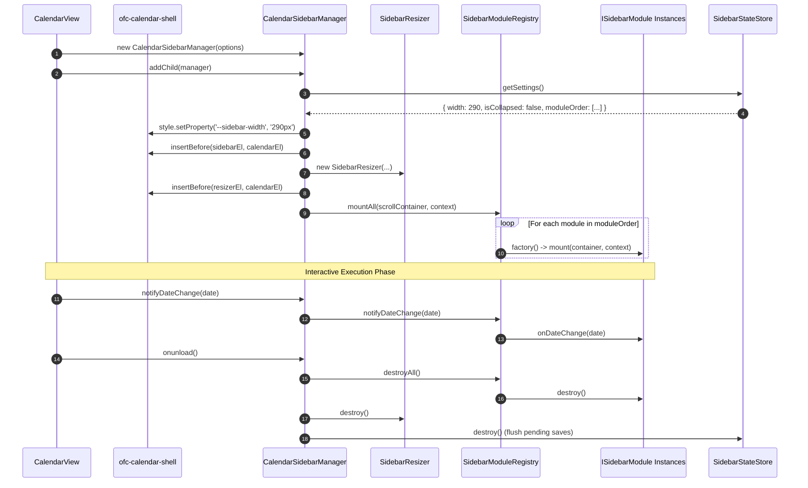

# Calendar Cockpit (Sidebar) Architecture

This document details the architectural design, component lifecycles, state persistence, and extensibility patterns of the **Calendar Cockpit** (`src/features/calendar-sidebar/`).

---

## Architectural Principles (SOLID & DRY)

The Cockpit is architected around strict separation of concerns, decoupling presentation cards from the core FullCalendar engine:

```
┌────────────────────────────────────────────────────────────────────────┐
│                      CalendarView (Obsidian ItemView)                  │
│                     Container: [ .ofc-calendar-shell ]                 │
└────────────────────────────────────┬───────────────────────────────────┘
                                     │
                 ┌───────────────────┴───────────────────┐
                 ▼                                       ▼
┌─────────────────────────────────┐    ┌─────────────────────────────────┐
│     CalendarSidebarManager      │    │     ofc-calendar-container      │
│  (src/features/calendar-sidebar)│    │     (FullCalendar Instance)     │
└────────────────┬────────────────┘    └────────────────┬────────────────┘
                 │                                      │
                 │◀──────────────[Resizer]─────────────▶│
                 │                 Divider              │
                 ▼                                      ▼
┌─────────────────────────────────┐    ┌─────────────────────────────────┐
│      SidebarModuleRegistry      │    │  fullCalendarView.updateSize()  │
└────────────────┬────────────────┘    └─────────────────────────────────┘
                 │
   ┌─────────────┼─────────────┬─────────────┐
   ▼             ▼             ▼             ▼
┌──────────────┐ ┌───────────┐ ┌─────────────┐ ┌──────────────┐
│MiniMonth     │ │UpNext     │ │TaskBacklog  │ │AgentHud      │
│Module        │ │Module     │ │Module       │ │Module        │
└──────────────┘ └───────────┘ └─────────────┘ └──────────────┘
```

### 1. SOLID Design Analysis

* **Single Responsibility (SRP):**
    * [`CalendarSidebarManager`](file:///d:/Codes/plugin-full-calendar/src/features/calendar-sidebar/CalendarSidebarManager.ts): Manages lifecycle mounting, responsive visibility, and container coordination.
    * [`SidebarResizer`](file:///d:/Codes/plugin-full-calendar/src/features/calendar-sidebar/SidebarResizer.ts): Encapsulates pointer events, clamping, and splitter DOM states.
    * [`SidebarStateStore`](file:///d:/Codes/plugin-full-calendar/src/features/calendar-sidebar/SidebarStateStore.ts): Encapsulates reading, writing, clamping, and debouncing configuration changes to Obsidian vault storage.
    * [`CollapsibleSection`](file:///d:/Codes/plugin-full-calendar/src/features/calendar-sidebar/components/CollapsibleSection.ts): Generic DRY UI wrapper handling accordion folding, chevrons, titles, and action slots.
    * Domain modules ([`MiniMonthModule`](file:///d:/Codes/plugin-full-calendar/src/features/calendar-sidebar/modules/MiniMonthModule.ts), [`UpNextWeatherModule`](file:///d:/Codes/plugin-full-calendar/src/features/calendar-sidebar/modules/UpNextWeatherModule.ts), [`TaskBacklogModule`](file:///d:/Codes/plugin-full-calendar/src/features/calendar-sidebar/modules/TaskBacklogModule.ts), [`AgentHudModule`](file:///d:/Codes/plugin-full-calendar/src/features/calendar-sidebar/modules/AgentHudModule.ts)): Each module is strictly responsible for its own data rendering and user interaction.
* **Open / Closed (OCP):**
    * New modules register via `registry.registerModuleFactory(id, factory)` without requiring any modifications to the core manager or existing modules.
* **Liskov Substitution (LSP):**
    * The registry interacts with all cards uniformly through the [`ISidebarModule`](file:///d:/Codes/plugin-full-calendar/src/features/calendar-sidebar/types.ts) contract. Modules can be swapped, disabled, or reordered dynamically.
* **Interface Segregation (ISP):**
    * `ISidebarModule` requires only `mount(containerEl, context)` and `destroy()`. Notification hooks (`onDateChange`, `onDateRangeChange`, `onCacheUpdate`) are completely optional.
* **Dependency Inversion (DIP):**
    * Modules do not access the parent `CalendarView` DOM directly; they interact through the abstracted `SidebarContext` interface providing navigation and sizing APIs.

---

## Component Lifecycle & Coordination



---

## State Persistence & Debouncing Model

Changes to the sidebar layout (resizing width or folding accordion cards) occur frequently during active user workflows. To avoid saturating vault file I/O:

1. **In-Memory Mutex:** The [`SidebarStateStore`](file:///d:/Codes/plugin-full-calendar/src/features/calendar-sidebar/SidebarStateStore.ts) immediately updates `PluginState.getSettings().sidebarConfig` in-memory.
2. **Debounced Disk Sync:** It triggers `PluginState.saveSettings(false)`, which internally batches disk persistence via an asynchronous debounce timer.
3. **Flush on Unload:** When `CalendarView` unmounts, `SidebarStateStore.destroy()` invokes `PluginState.saveSettings(true)` with immediate flushing to guarantee zero state loss.

---

## Lazy-Loading & Jest Test Isolation

To preserve sub-millisecond plugin startup and isolate test environments from heavy ESM bundles:

* The [`SidebarModuleRegistry`](file:///d:/Codes/plugin-full-calendar/src/features/calendar-sidebar/modules/SidebarModuleRegistry.ts) supports asynchronous module instantiation (`SidebarModuleFactory = () => ISidebarModule | Promise<ISidebarModule>`).
* Modules that rely on complex external dependencies (such as `@fullcalendar/interaction` `Draggable` via `TaskBacklogModule`) are dynamically imported:
  ```typescript
  this.registerModuleFactory('task-backlog', async () => {
    const { TaskBacklogModule } = await import('./TaskBacklogModule');
    return new TaskBacklogModule(this.store);
  });
  ```
* This ensures that importing `CalendarView` in headless unit tests (e.g. `FullCalendarAPI.test.ts`) does not prematurely pull unmocked ESM libraries into CommonJS execution contexts.

---

## Responsive & Reflow Engineering

The split-pane layout uses native CSS Flexbox with custom properties:

```css
.ofc-calendar-shell {
  display: flex;
  flex-direction: row;
  --sidebar-width: 290px;
}

.ofc-calendar-sidebar {
  width: var(--sidebar-width, 290px);
  min-width: 200px;
  max-width: 520px;
}

.ofc-calendar-shell .ofc-calendar-container {
  flex: 1 1 0;
  min-width: 0;
}
```

* **Dynamic Reflow:** As the user drags the splitter, [`SidebarResizer`](file:///d:/Codes/plugin-full-calendar/src/features/calendar-sidebar/SidebarResizer.ts) updates `--sidebar-width` on the container element in real-time. On pointer release, it executes `context.triggerResize()`, invoking `fullCalendarView.updateSize()`.
* **Zero Mobile Interference:** Mobile clients (`.is-phone`) completely omit `.ofc-calendar-sidebar` and `.ofc-calendar-sidebar-resizer` via `display: none`, giving the calendar canvas 100% viewport width without runtime overhead.
