# Calendar Agent Architecture

This document details the architectural layout, security boundaries, synchronization model, data flow, and components of the **Calendar Agent (Managed AI & BYOK)** subsystem in Full Calendar Remastered.

---

## Architectural Workflow & Topology

The agent subsystem follows strict Dependency Inversion (`IAgentClient`), decoupling the conversation orchestration engine (`AgentEngine`) and shared calendar write-approval gate (`AgentCalendarBridge`) from the active transport provider:

* **Managed AI Transport (`src/features/agent/infrastructure/managed/`)** — Default out-of-the-box mode communicating with the GDPR-compliant, Zero Data Retention Cloudflare Worker + Durable Object gateway (`gateway.full-calendar-remastered.in`) using Web Crypto **ECDSA P-256** request signatures, activate-once Paddle licensing (`HMAC-SHA256` indexed), and read-only server balance projections (`UsageSnapshotCache`).
* **BYOK Transport (`src/features/agent/core/AgentClient.ts`)** — Direct OpenAI-compatible client supporting OpenAI, OpenRouter, Groq, DeepSeek, Ollama, and LM Studio.

```mermaid
flowchart TD
    subgraph UI ["Presentation Layer (Synchronized Chat Surfaces)"]
        SidebarView["AgentSidebarView (Right Leaf ItemView)"]
        HudWriteBar["AgentHudModule / AgentWriteBar (Cockpit HUD)"]
        CmdModal["AgentCommandModal (Quick Modal)"]
        ChatComp["AgentChatComponent (Shared Chat Engine UI)"]
        Welcome["AgentWelcomeView (Copilot Starters)"]
        Trace["AgentStepTraceView (Collapsible Steps)"]
        LiveBar["AgentLiveActivityBar (Docked Strip)"]
        ProposalCard["ProposalApprovalCard + proposalFormatters"]
        BulkBar["ProposalBulkActionBar (Approve/Reject All)"]
        Chips["FollowUpChipsView (Dynamic Next Steps)"]
        AuditModal["AgentAuditModal (JSONL Diagnostics)"]
    end

    subgraph Core ["Orchestration & Transport"]
        Engine["AgentEngine (Pub/Sub Bus, Snapshot Hydration & Loop)"]
        CtxWin["contextWindowBuilder (Prefix-Cache Window)"]
        Spec["SpecLoader (Prompt & Taxonomy Injection)"]
        Contract["IAgentClient (Transport Interface)"]
        ManagedClient["ManagedAgentClient (P-256 Signed SSE)"]
        ByokClient["AgentClient (BYOK SSE + CORS Fallback)"]
        SseParser["SseChunkParser + abortUtils"]
    end

    subgraph Bridge ["Sandboxed Calendar Bridge"]
        CalBridge["AgentCalendarBridge (Zero Vault Access + Write Gate)"]
        TitleNorm["eventTitleNormalizer (Clean Title & Toggle Contract)"]
        WebTool["webBrowseTool (SSRF-Guarded + raceWithAbort)"]
    end

    subgraph Storage ["Plugin-Confined Storage"]
        Store["AgentStorage (.obsidian/plugins/.../agent/)"]
        Sessions["sessions.json (Multi-Session Threads)"]
        Audit["audit.jsonl (Rolling Diagnostic Logs)"]
    end

    subgraph Host ["Obsidian Host & Core"]
        EventCache["PluginState.getCache() (Calendar Engine)"]
        ObsidianNet["Obsidian requestUrl (Node/Electron Backend)"]
        Keychain["SecretStorage (app.secretStorage)"]
    end

    SidebarView --> ChatComp
    HudWriteBar --> ChatComp
    CmdModal --> ChatComp
    ChatComp --> Welcome
    ChatComp --> Trace
    ChatComp --> LiveBar
    ChatComp --> ProposalCard
    ChatComp --> BulkBar
    ChatComp --> Chips
    SidebarView --> AuditModal

    ChatComp <-->|Pub/Sub & Snapshot| Engine
    SidebarView <-->|Session Events| Engine
    Engine --> CtxWin
    Engine --> Spec
    Engine --> Contract
    Engine --> CalBridge
    Engine --> Store

    Contract --> ManagedClient
    Contract --> ByokClient
    ByokClient --> SseParser
    ManagedClient -->|Signed Fetch SSE| Gateway["gateway.full-calendar-remastered.in"]
    ByokClient -->|Fetch SSE| Cloud["OpenAI / BYOK / Local Endpoint"]
    ByokClient -->|CORS Fallback| ObsidianNet
    ManagedClient -.->|ECDSA P-256 Key & Tokens| Keychain
    ByokClient -.->|API Key| Keychain

    CalBridge --> TitleNorm
    CalBridge -->|Read Only Queries| EventCache
    CalBridge -->|Stage Mutations| ProposalCard
    ProposalCard -->|Explicit User Approval| EventCache

    CalBridge --> WebTool
    WebTool --> ObsidianNet

    Store --> Sessions
    Store --> Audit
```



---

## Key Components

### 1. Transport Layer (`IAgentClient`, `ManagedAgentClient`, `AgentClient`)

All model transports implement `IAgentClient` (`src/features/agent/domain/contracts/IAgentClient.ts`) with unified `StreamCallbacks`: `onChunk`, `onReasoningDelta`, `onToolCallDelta`, and `onRetry`.

#### Managed Transport (`ManagedAgentClient`)
Implemented in `src/features/agent/infrastructure/managed/client/ManagedAgentClient.ts`:
* **Strict Allowlisted Payload**: Sends only `messages` (sanitized via `sanitizeChatMessages`), `stream`, and optional `tools` — never model names, `temperature`, `n`, or upstream provider URLs.
* **ECDSA P-256 Signing & Token Refresh**: Signs requests with `RequestSigner` and delegates bearer refresh via `tokenProvider.withAccessToken()`, preserving the per-request `idempotencyKey` on HTTP 401 retry.
* **Authoritative Usage Accounting**: `StreamingTransport` parses terminal `fcr:usage` and `fcr:error` custom SSE events, updating the read-only `UsageSnapshotCache` directly from server settlements.

#### BYOK Transport (`AgentClient`)
Implemented in `src/features/agent/core/AgentClient.ts`:
1. **Desktop Electron CORS Bypass & Abort Safety**: In `executeHttp()`, `chatCompletion()` attempts `window.fetch` for native `ReadableStream` SSE first. If Chromium throws a CORS `TypeError` (and the request has neither been aborted nor emitted any partial output), it falls back to Obsidian's Electron/Node `requestUrl` with `stream: false`, wrapped in `raceWithAbort()` (`src/features/agent/domain/abortUtils.ts`) so **Stop** cancels stalled fallback calls immediately instead of hanging until socket timeout. `testConnection()` uses `requestUrl({ throw: false })` directly.
2. **Pure SSE Parsing (`SseChunkParser`)**: `src/features/agent/domain/sseParser.ts` handles CRLF/LF framing, multi-line `data:` blocks, trailing usage-only frames, in-stream JSON error extraction, colliding `index: 0` tool-call ID slots emitted by some local LLMs (e.g. Ollama), and reasoning streams (`delta.reasoning_content` / `delta.reasoning`) routed strictly to `onReasoningDelta` so chain-of-thought never leaks into assistant reply bubbles.
3. **Post-Abort & Partial-Output Guards**: Once `signal.aborted` is raised or partial output (`onChunk`, `onReasoningDelta`, `onToolCallDelta`) has started emitting, late callback emissions are suppressed and network retries are disallowed to avoid duplicate response text.
4. **Exponential Backoff & Temperature Auto-Healing**: Applies jittered backoff on HTTP 429 (honoring `Retry-After`) and 5xx / transient timeouts while distinguishing 429 rate limits from server errors in retry status notifications. If a provider rejects `temperature` on HTTP 400 (`unsupported parameter` / `deprecated`), `AgentClient` strips `temperature` and retries once automatically.

---

### 2. Sandboxed Bridge (`AgentCalendarBridge`)
`src/features/agent/tools/AgentCalendarBridge.ts` enforces strict isolation between the AI layer and Obsidian/calendar persistence:

#### Architectural Invariants
1. **Zero Vault Access**: Never imports or reads `app.vault`; interacts exclusively with `PluginState.getCache()` and `PluginState.getProviderRegistry()`.
2. **Cryptographic & Concurrency Write-Approval Gate**:
   * **Staging Only**: Tool calls (`stageCreateEvent`, `stageUpdateEvent`, `stageDeleteEvent`, `stageBatchCreateEvents`) stage in-memory `EventProposal` records without modifying `EventCache`. `DeleteEventProposal` also snapshots the target event's schedule, recurrence flag, and optional category metadata for clear review in the UI.
   * **SHA-256 `approvalHash` & 5-Minute TTL**: Every staged proposal carries a canonical SHA-256 `approvalHash` (`src/features/agent/domain/crypto/sha256.ts`) verified on commit and recomputed live when `BATCH_CREATE` item checkboxes change. Uncommitted proposals expire after `PROPOSAL_TTL_MS` (5 minutes).
   * **Optimistic Concurrency & TOCTOU Protection**: `UPDATE` and `DELETE` store a `sourceSnapshotHash` of the original event and abort commit if the event changed externally after preview. `inFlightProposalIds` prevents concurrent duplicate applies, and `appliedMutationKeys` retains 30 days of idempotency keys (capped at 500 entries).
   * **Transient-Error Retryability**: `isProposalActionable()` remains `true` for unexpired `'PENDING'` or `'FAILED'` proposals still retained in `pendingProposals`, letting transient provider errors recover via **Retry apply** while permanent failures (expiry, external modification, missing target event, or disabled-categorization conflicts) remove the proposal cleanly.
3. **Schema Validation**: All staged events pass `validateEvent()` (`src/types/schema.ts`) before entering `pendingProposals`.
4. **Taxonomy & `enableAdvancedCategorization` Contract**: Delegated to `src/features/agent/domain/eventTitleNormalizer.ts` (`extractCleanTitle`, `normalizeEventTitleFields`):
   * **When Enabled**: `getEvents()` and staging helpers strip at most one leading `category - ` and/or `subCategory - ` segment (case-insensitively, without collapsing genuine repeated words inside a title) so `EventEnhancer` can format `Category - SubCategory - Title` cleanly on save without ever producing duplicated prefixes on round-trip.
   * **When Disabled**: Event titles remain literal without prefix stripping, `category`/`subCategory` are stripped both on stage and inside `commitProposal()`, and category-only `UPDATE` proposals are rejected at commit time.

#### Proposal Lifecycle
```text
                 [Agent Tool Call]
                         │
                         ▼
               stageProposal(...) ──► Status: PENDING (5m TTL, SHA-256 hash)
                         │
           ┌─────────────┴─────────────┐
           ▼                           ▼
  commitProposal(...)          rejectProposal(...)
  (Explicit User Click)        (Explicit User Click)
           │                           │
     ┌─────┴──────┐                    ▼
     ▼            ▼              Status: REJECTED
 (Success)   (Transient Fail)    (Removed from Pending)
     │            │
     ▼            ▼
 APPROVED     FAILED (Retained in Pending -> Retry apply)
 (Applied)    (Permanent fail/TTL expiry deletes from Pending)
```

---

### 3. Orchestration Engine (`AgentEngine`)
`src/features/agent/core/AgentEngine.ts` manages session state, multi-panel synchronization, context construction, and multi-turn tool execution (up to `MAX_TURNS = 5`):

* **Observable Pub/Sub Event Bus & Snapshot Hydration**: Exposes `subscribe()` emitting typed `AgentEngineEvent` updates (`run-start`, `status`, `turn-start`, `chunk`, `turn-complete`, `tool-start`, `tool-end`, `proposal-staged`, `proposal-updated`, `proposal-selection-changed`, `settings-changed`, `retry`, `session-changed`, `run-end`), alongside `getActiveRunSnapshot()` (`AgentActiveRunSnapshot`), `abortActiveRun()`, `notifyProposalUpdated()`, `notifyProposalSelectionChanged()`, and `notifySettingsUpdated()`. Newly opened panels call `getActiveRunSnapshot()` to hydrate mid-stream traces, text, and timers instantaneously.
* **Concurrency & Session Isolation**: `init()` deduplicates concurrent startup via `initPromise`. Creating, switching, or clearing a session calls `detachActiveRun()`, aborting and clearing active run ownership immediately so orphaned streams cannot bleed into another session.
* **Dynamic Context & Prefix-Cache-Safe Windowing**: `SpecLoader` (`src/features/agent/core/SpecLoader.ts`) injects active timezone, 12h/24h format, writable calendars, toggle-aware taxonomy instructions, and `<suggestions>` guidance. `contextWindowBuilder.ts` (`src/features/agent/core/contextWindowBuilder.ts`) stamps immutable per-user-message `[Current Local Time: ...]` metadata, applies turn-aware tool output compaction (preserving `get_events` IDs), and performs atomic 25% oldest-turn-group eviction within `maxMessages = 80` and `maxTotalChars = 22,000`.
* **Live Reasoning, Tool Preparation & Resilient Parsing**: Translates `onReasoningDelta` (`Reasoning...`), `onToolCallDelta` (`Preparing ...`), and HTTP 429 vs server retry states into live `status` events; repairs fenced/malformed JSON arguments emitted by local LLMs; runs a follow-up summary turn after staging proposals; extracts trailing `<suggestions>[...]</suggestions>` chips via `suggestionsParser.ts`; and forwards `AbortSignal` into `browseScheduleOnline`.

---

### 4. Plugin-Confined Storage (`AgentStorage`)
`src/features/agent/core/AgentStorage.ts` manages persistence strictly inside `.obsidian/plugins/full-calendar-remastered/agent/`:

* **`sessions.json`**: Persists all conversation sessions, messages (including `toolSteps` and `suggestions`), and attached proposals across restarts.
* **`audit.jsonl`**: Append-only JSON Lines audit log with automated rolling pruning capped at 1,000 entries.
* **`agent-spec.md`**: Cached local copy of the remote specification prompt.
* **Zero Vault Residue**: All state lives inside the plugin directory, leaving zero leftover markdown notes or metadata in the user's vault.

---

### 5. Web Scraping & SSRF Defense (`webBrowseTool`)
`src/features/agent/tools/webBrowseTool.ts` fetches online syllabi, conference schedules, and `.ics` feeds via Obsidian's `requestUrl`:

* **SSRF Protection**: Rejects non-`http(s)` schemes, `.localhost` / `.local` / `.internal` hostnames, private/loopback/CGNAT IPv4 ranges (`0.0.0.0/8`, `10.0.0.0/8`, `100.64.0.0/10`, `127.0.0.0/8`, `169.254.0.0/16`, `172.16.0.0/12`, `192.168.0.0/16`), and private/mapped IPv6 addresses (`::`, `::1`, `::ffff:*`, `fe80::/10`, `fc00::/7`).
* **Sanitization & Binary Guard**: Rejects binary MIME types (`image/*`, `audio/*`, `video/*`, `application/octet-stream`, `application/pdf`, `application/zip`), passes `.ics` feeds directly, and strips `<script>`, `<style>`, `<noscript>`, `<svg>`, `<header>`, `<footer>`, and `<nav>` tags from HTML pages.
* **Payload Cap & Cancellation**: Truncates extracted output at `MAX_OUTPUT_CHARS = 15000` characters and wraps `requestUrl` with `raceWithAbort(promise, signal)` so **Stop** aborts slow downloads immediately.

---

### 6. Presentation Layer (`AgentChatComponent` & Synchronized Views)

A single reusable Obsidian `Component`, `AgentChatComponent` (`src/features/agent/ui/AgentChatComponent.ts`), powers all three surfaces:
* **`AgentSidebarView` (`FULL_CALENDAR_AGENT_VIEW`)**: Persistent Right Sidebar leaf (`src/features/agent/ui/AgentSidebarView.ts`) with session dropdown (guarded against stale async responses via `dropdownRefreshSeq` & `isViewClosed`), create/delete session actions, and `AgentAuditModal`.
* **`AgentHudModule` / `AgentWriteBar`**: Docked inside the Left Cockpit (`src/features/calendar-sidebar/modules/AgentHudModule.ts`, `src/features/agent/ui/AgentWriteBar.ts`) with a one-click launcher into the Right Sidebar Leaf.
* **`AgentCommandModal`**: Command palette quick dialog (`src/features/agent/ui/AgentCommandModal.ts`).

#### Dual-Panel Sync, Component & Layout Design
* **Echo Suppression & Scroll Preservation**: Every panel assigns itself a unique `panelId`. Decision broadcasts (`proposal-updated`, `proposal-selection-changed`) include `originPanelId`, allowing peer panels to update affected cards in place via `syncStatus()` / `refreshDisplay()` without rebuilding scroll containers or resetting `scrollTop`.
* **Safe Lifecycle & Concurrency Guards**: Standalone instances without a `parentComponent` invoke `this.load()` in the constructor so child markdown renders register cleanly; `beforeSend()` re-entry is blocked via `isSubmitting`; cancelled runs purge uncompleted assistant bubbles; and `MarkdownRenderer` waits on async image/table layout before conditional `followScroll`.
* **Modular Subviews**:
  * **`AgentWelcomeView`**: Copilot-style empty-state starters (5 full cards / 4 compact pills; auto-send queries vs pre-filled templates).
  * **`AgentStepTraceView`**: Collapsible `<details>` trace displaying tool-step execution, late-mount `startedAt` timer reconstruction, and automatic DOM re-anchoring across multi-turn tool loops.
  * **`AgentLiveActivityBar`**: Persistent docked strip anchored between the scroll container and composer/Stop button with pulsing status dot, live phase text, singular/plural step badge, 200ms elapsed timer, and click-to-jump-to-bottom.
  * **`ProposalApprovalCard` & `proposalFormatters`**: Neutral container + 3px type accent rail, header schedule badge (formatted via pure `src/features/agent/ui/proposalFormatters.ts` respecting 12h/24h, timezone-safe local `YYYY-MM-DD`, multi-day spans, cross-year dates, and recurring markers), toggle-aware `Category › SubCategory` color-dot breadcrumb, stacked `−`/`+` inset diffs, divider-free footer, single-line compact resolved row, live `settings-changed` re-rendering via `AgentManager.updateSettings()`, and optional `onEditInModal` callback hook.
  * **`ProposalBulkActionBar` & `FollowUpChipsView`**: Sticky `Reject all` / `Approve all (N)` bar for 2+ actionable pending proposals and up to 3 clickable contextual follow-up chips.
* **CSS Containment Invariants (`src/features/agent/ui/styles/agent.css`)**: `.ofc-agent-sidebar-messages > * { flex-shrink: 0; }` prevents flex compression from collapsing step traces in overflowing threads, while `.workspace-leaf-content[data-type='full-calendar-agent-view'] .view-content` and `min-height: 0` bound leaf viewport height so the live activity bar and composer stay pinned at the bottom.

---

## Related Documentation

*   [Calendar Agent User Guide](../../../user/features/agent.md)
*   [Agent API & Tool Specification](../../api/agent-spec.md)
*   [Calendar Cockpit Architecture](../../views/calendar-sidebar-architecture.md)
*   [Styling Architecture & CSS Audit](../styling.md)
*   [Event Cache Architecture](../eventcache.md)
*   [REST API & CLI Architecture](../api-architecture.md)
